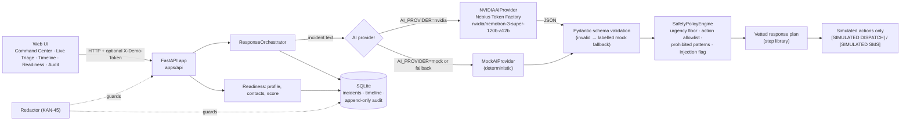

# LifeRescue — AI Emergency Coordination & Readiness Platform

> **Hackathon Edition (NVIDIA / Nebius AI Cloud)**  
> Governed AI emergency-response prototype combining acute triage, coordinated (simulated) response, and personal preparedness.
>
> **AI proposes. Deterministic safety policy decides.**
>
> ⚠️ Hackathon prototype. All dispatches, SMS and notifications are **simulated** — LifeRescue never contacts real emergency services or people. It is not a medical device; in an emergency call 112 / 911 / your local number.

---

## 1. Executive Summary

**LifeRescue** is a security-first, auditable emergency coordination system designed to assist people during life-threatening crises and help them prepare before emergencies strike.

Instead of generic chatbot conversations, LifeRescue operates through **governed state machines**, **deterministic safety policies**, and **defense-in-depth secret redaction**.

### Three Core Capabilities Inside One Unified Application

```
                     ┌─────────────────────────────────────────┐
                     │            LifeRescue UI                │
                     │  (Dashboard • Triage • Timeline • Readiness)
                     └────────────────────┬────────────────────┘
                                          │
                                          ▼
                     ┌─────────────────────────────────────────┐
                     │            REST API Gateway             │
                     │   (/incidents, /profile, /contacts)     │
                     └────────────────────┬────────────────────┘
                                          │
    ┌─────────────────────────────────────┼─────────────────────────────────────┐
    │                                     │                                     │
    ▼                                     ▼                                     ▼
┌──────────────────────────┐  ┌──────────────────────────┐  ┌──────────────────────────┐
│       Capability A       │  │       Capability B       │  │       Capability C       │
│  Emergency Understanding │  │     Emergency Action     │  │    Personal Emergency    │
│        & Triage          │  │  Response Coordination   │  │   Readiness & Prevention │
└────────────┬─────────────┘  └────────────┬─────────────┘  └────────────┬─────────────┘
             │                             │                             │
             │ AI Triage                   │ Vetted Action Plan          │ Preparedness Score
             ▼                             ▼                             ▼
┌──────────────────────────┐  ┌──────────────────────────┐  ┌──────────────────────────┐
│   Safety Policy Engine   │──▶│   Response Orchestrator  │  │ Profile & Contacts Repo  │
│(Deterministic Guardrails)│  │ (Simulation / Dispatch)  │  │   (Defensive Redaction)  │
└──────────────────────────┘  └────────────┬─────────────┘  └──────────────────────────┘
                                           │
                        ┌──────────────────┴──────────────────┐
                        ▼                                     ▼
           ┌─────────────────────────┐           ┌─────────────────────────┐
           │      Timeline Audit     │           │   Notification Provider │
           │   (Full Event History)  │           │   (Simulated / Dispatched)
           └─────────────────────────┘           └─────────────────────────┘
```

- **Capability A — Emergency Understanding & Triage:**  
  Accepts unstructured natural language, structured reports, voice transcripts, or sensor alerts. Extracts key facts, classifies urgency (Low, Medium, High, Critical), highlights missing life-critical details (location, consciousness), and prioritizes emergency escalation.
- **Capability B — Emergency Action & Response Coordination:**  
  Translates triage analysis into actionable response steps (dispatching emergency responders, alerting primary contacts, assembling responder medical dossiers, and displaying first-aid instructions). External notifications run in a governed simulation sandbox during demo mode.
- **Capability C — Personal Emergency Readiness & Prevention:**  
  Proactively audits medical profiles, allergies, medications, and primary contacts. Calculates an instant preparedness score (0–100%) and identifies specific vulnerabilities before an emergency occurs.

---

### The problem

In the first minutes of an emergency (cardiac event, road collision, wildfire), people panic, forget critical facts and lose time. Generic chatbots can help explain, but an LLM alone can under-rate a life threat, be prompt-injected, or invent actions. LifeRescue uses an NVIDIA Nemotron model for understanding, while every escalation decision and every action passes a deterministic, code-enforced safety policy.

### Architecture overview



Workflow: **PREPARE → EMERGENCY → UNDERSTAND → DECIDE SAFELY → RESPOND → LEARN/PREPARE**.

### Safety differentiator — "AI proposes. Deterministic safety policy decides."

- **Urgency floor:** a deterministic life-threat lexicon (incl. Hindi/Hinglish phrases) sets a minimum urgency; the model can only *raise* urgency, never lower it. Verified live: Nemotron rated a test case `high`, the policy raised it to `critical` (`RULE_ACUTE_LIFE_THREAT_ESCALATION`).
- **Action allowlist:** only known action types/ids execute; an unknown action id is rejected with HTTP 400. Prohibited patterns (dosing, shell commands, etc.) are blocked.
- **Vetted steps:** user-facing steps come from a step library; a "call 112/911" step is always shown, plus crisis lines (988, Tele-MANAS 14416) for self-harm.
- **Prompt injection:** suspected injection is flagged (`prompt_injection_attempt_detected`) and cannot downgrade urgency.
- **Simulation boundary:** every action is status `simulated` and labelled `[SIMULATED …]` in API and UI.
- **Audit:** every analysis, policy decision and action is recorded; SQLite triggers block UPDATE/DELETE on audit events.
- **Secrets:** redaction on logs/DB/API responses; gitleaks in CI; demo access token required for any non-localhost bind.

## 2. Key Architecture Principles

1. **Deterministic Safety Policy Boundary:**  
   The LLM is never the final policy authority. Proposed actions pass through `SafetyPolicyEngine` which enforces action allowlists, blocks unsafe/prohibited instructions (such as prescriptive drug dosing, shell execution, or financial transfers), and forces emergency escalation for life-threatening conditions (e.g., chest pain, breathing compromise, heavy bleeding).
2. **Provider-Agnostic AI Gateway:**  
   Runs locally without any external credentials using `MockAIProvider`. Connects to NVIDIA Nemotron on Nebius Token Factory (OpenAI-compatible API) via `NVIDIAAIProvider` when `AI_PROVIDER=nvidia` and `NEBIUS_API_KEY` are set.
3. **Defense-in-Depth Secret Redaction (KAN-45):**  
   Every log line, exception, database write, API response, and audit trail record is guarded by the KAN-45 `Redactor`. Canaries and API keys are scrubbed before reaching any persistence layer or client.
4. **Governed Auditability:**  
   Every state change, triage evaluation, policy ruling, and action execution generates a structured `AuditEvent`, stored append-only (SQLite triggers reject UPDATE/DELETE).

---

## 3. Quickstart (Zero External Credentials Required)

LifeRescue is designed to run locally right out of the box with zero external API keys.

### 1. Requirements
- Python 3.11+ (CI tests 3.11–3.14)

### 2. Install and launch

```bash
git clone https://github.com/ojas005/liferescue && cd liferescue
python -m venv .venv && source .venv/bin/activate
pip install -r requirements.txt -r apps/api/requirements.txt
cp .env.example .env          # optional; defaults are mock mode on 127.0.0.1:8000
python apps/api/run.py
```

### Environment variables

| Variable | Default | Purpose |
|---|---|---|
| `AI_PROVIDER` | `mock` | `mock` (deterministic, no credentials) or `nvidia` (Nemotron on Nebius Token Factory; `nebius` is accepted as an alias) |
| `NEBIUS_API_KEY` | — | Nebius Token Factory key. Env/.env only, never commit. `NVIDIA_API_KEY` is an alias |
| `NVIDIA_MODEL` | `nvidia/nemotron-3-super-120b-a12b` | Model id |
| `NVIDIA_BASE_URL` | `https://api.tokenfactory.nebius.com/v1/` | OpenAI-compatible endpoint |
| `AI_TIMEOUT_S` | `20` | Model call timeout (1–60 s) |
| `DB_PATH` | `./liferescue.db` | SQLite file (`:memory:` allowed) |
| `HOST` / `PORT` | `127.0.0.1` / `8000` | Bind address |
| `DEMO_ACCESS_TOKEN` | — | Required for any non-localhost bind; sent as `X-Demo-Token`. Env only |
| `DEMO_REQUIRE_TOKEN` | `0` | `1` forces the token even on localhost (use with tunnels) |
| `CORS_ORIGINS` | localhost allowlist | Comma-separated origins; `*` ignored |
| `DEMO_MODE` | `true` | Demo mode (actions simulated) |
| `RATE_LIMIT_REQUESTS` | `20` | Max POSTs per client IP per window on `/incidents`, `/incidents/{id}/analyze`, `/demo/scenarios/{id}/run`, `/demo/reset` (`0` disables). Over limit → HTTP 429 |
| `RATE_LIMIT_WINDOW_S` | `60` | Rate-limit window in seconds |
| `TRUST_PROXY` | `0` | `1` = behind Render/Cloudflare: use `CF-Connecting-IP` (set by Cloudflare, client values overwritten) as client IP, else the rightmost `X-Forwarded-For` hop; client-supplied left hops and `X-Real-IP` are ignored. `0` = socket peer only |
| `AI_GLOBAL_CALLS_PER_MINUTE` | `30` | Global per-minute rate limit on outbound Nebius/NVIDIA model calls, across all visitors and workers (`0` = no per-minute limit). Over it, analysis uses the labelled mock (`mock_fallback: global_rate_limit`) |
| `AI_DAILY_CALL_BUDGET` | `500` | Model calls per rolling 24 h window, across all visitors and workers (`0` = no live model calls). Once used up: labelled mock (`mock_fallback: daily_budget_exhausted`); Nebius is not called |

### 3. Open the Experience
- **Interactive Web App:** [http://127.0.0.1:8000](http://127.0.0.1:8000)
- **Interactive OpenAPI Documentation:** [http://127.0.0.1:8000/docs](http://127.0.0.1:8000/docs)
- **Health Endpoint:** [http://127.0.0.1:8000/health](http://127.0.0.1:8000/health)

---

## 4. One-Click Hackathon Scenarios

The web interface includes interactive one-click demonstration scenarios:

1. **Scenario 1 — Acute Medical Emergency:**  
   Patient reports severe crushing chest pain radiating to left arm and shortness of breath. LifeRescue detects critical cardiovascular compromise, mandates 911 dispatch, alerts the primary spouse contact, compiles a paramedic medical dossier, and renders calm first-aid steps.
2. **Scenario 2 — Highway Traffic Collision:**  
   Multi-vehicle collision on interstate with passenger injury. LifeRescue extracts roadway hazards, flags missing vehicle counts, and coordinates emergency dispatch.
3. **Scenario 3 — Wildfire / Hazmat Evacuation:**  
   Approaching ridge fire with smoke hazard. Triggers immediate evacuation directives and outdoor assembly coordination.

---

## 5. REST API Specification

| Method | Endpoint | Description |
|---|---|---|
| `POST` | `/incidents` | Create a new emergency intake |
| `GET` | `/incidents` | List recent incidents |
| `GET` | `/incidents/{id}` | Retrieve incident details |
| `POST` | `/incidents/{id}/analyze` | Trigger AI triage and risk classification |
| `GET` | `/incidents/{id}/analysis` | Retrieve structured AI analysis facts |
| `POST` | `/incidents/{id}/respond` | Generate and execute/simulate response plan |
| `GET` | `/incidents/{id}/timeline` | Retrieve chronological timeline events |
| `GET` | `/emergency-profile` | Get emergency medical profile |
| `PUT` | `/emergency-profile` | Update medical history, allergies, directives |
| `GET` | `/contacts` | List designated emergency contacts |
| `GET` | `/contacts/{id}` | Retrieve single emergency contact |
| `POST` | `/contacts` | Add a new emergency contact |
| `PUT` | `/contacts/{id}` | Update contact details or primary flag |
| `DELETE` | `/contacts/{id}` | Delete an emergency contact |
| `GET` | `/readiness` | Compute preparedness score and gaps |
| `GET` | `/demo/scenarios` | List available demo scenarios |
| `POST` | `/demo/scenarios/{id}/run` | Execute complete end-to-end scenario |
| `GET` | `/audit/events` | Inspect append-only security audit records |
| `GET` | `/health` | Service status and runtime flags |

---

## 6. Testing & Quality Assurance

LifeRescue includes a comprehensive, multi-layer automated test suite:

```bash
# Run Unit Tests (Domain models, safety engine, storage, AI providers)
python -m unittest discover -s tests/unit

# Run Integration Tests (FastAPI endpoints, middleware, headers, audit)
python -m unittest discover -s tests/integration

# Run End-to-End Workflow Tests (Scenarios 1-3, readiness lifecycle)
python -m unittest discover -s tests/e2e

# Run Security & Secret Redaction Suite (KAN-45)
python -m unittest discover -s tests/security
```

Full suite with pytest (as in CI): `pytest`

**Fresh-clone results on `main` @ `65ec75c` (2026-10-27, Python 3.13, `NEBIUS_API_KEY` unset):**

- pytest: 323 collected — 322 passed, 0 failed, 1 skipped (the gitleaks end-to-end sweep skips when the pinned gitleaks 8.30.1 binary is not on `PATH`; with it on `PATH`: 323 passed).
- `unittest` scripts suite: 321 run, OK (1 skipped); `tests/security`: 202 run, OK (1 skipped).
- ruff format/check clean; mypy clean (110 files); gitleaks full history: no leaks; pip-audit: no known vulnerabilities.
- No test needs network or API keys (Nebius calls are stubbed with `httpx.MockTransport`).

---

## 7. Connecting Real NVIDIA / Nebius AI Keys (Optional)

When real inference API keys are available, simply configure `.env` (or set environment variables):

```env
AI_PROVIDER=nvidia
NEBIUS_API_KEY=<your Nebius Token Factory key>   # never commit; NVIDIA_API_KEY is an alias
NVIDIA_MODEL=nvidia/nemotron-3-super-120b-a12b
NVIDIA_BASE_URL=https://api.tokenfactory.nebius.com/v1/
```

Only incident triage (analysis) is model-backed; response plans and readiness stay deterministic. Model output is schema-validated and always passes the deterministic `SafetyPolicyEngine` before any (simulated) action. If the provider is unreachable, times out, rejects the key, or returns invalid JSON, LifeRescue falls back to the deterministic triage provider and labels it visibly: `provider_name` becomes `nvidia_ai (mock_fallback: <reason>)`, `/health` reports `ai_mode: "fallback"`, the audit event carries `fallback: true`, and the UI badge says MOCK fallback. Run `python scripts/smoke_nvidia.py` to verify a live call.

**Verified live evidence (2026-10-27, IST):** with `AI_PROVIDER=nvidia`, `scripts/smoke_nvidia.py` returned `LIVE OK` from `nvidia/nemotron-3-super-120b-a12b` via `https://api.tokenfactory.nebius.com/v1/` in 5187 ms, the reply passed `AIAnalysis` schema validation, the model said `high`, and the deterministic policy raised it to `critical`. A full HTTP run of all three scenarios plus a manual incident in live mode served all four analyses from Nemotron (`provider_name: nvidia_ai (nvidia/nemotron-3-super-120b-a12b)`), with `/health` reporting `ai_mode: live`, `ai_last_status: live_ok`. Single-run latencies; not a benchmark.

---

## 7b. Exposing the Demo Beyond Localhost (Access Token)

By default the server binds to `127.0.0.1` and needs no token. If you bind to anything else
(`HOST=0.0.0.0`, a LAN IP, a hosted demo), the server **refuses to start** unless
`DEMO_ACCESS_TOKEN` is set:

```bash
export DEMO_ACCESS_TOKEN="$(python -c 'import secrets; print(secrets.token_urlsafe(24))')"
HOST=0.0.0.0 python apps/api/run.py
```

- `DEMO_ACCESS_TOKEN` is an **environment variable only**. Never commit it or put it in `.env.example`.
- With the token set, every API route except `/health` (and the static UI shell) requires the header
  `X-Demo-Token: <token>`; comparison is constant-time and the value is never logged or echoed.
- The web UI shows a token prompt after a 401 and keeps the value in `sessionStorage` only.
- **Tunnels count as public exposure.** ngrok, cloudflared, `ssh -R`, VS Code/Codespaces port
  forwarding, or any reverse proxy make a `127.0.0.1` server reachable from the internet while the
  bind check still sees localhost. Before using one, set `DEMO_ACCESS_TOKEN` **and**
  `DEMO_REQUIRE_TOKEN=1`, which forces the token even on localhost (startup fails if the token is missing):

  ```bash
  export DEMO_ACCESS_TOKEN="$(python -c 'import secrets; print(secrets.token_urlsafe(24))')"
  DEMO_REQUIRE_TOKEN=1 python apps/api/run.py   # then start the tunnel
  ```
- When no token is set, `run.py` prints a startup warning that the gate is open.
- CORS is an explicit allowlist (`http://localhost:<port>`, `http://127.0.0.1:<port>`; override with `CORS_ORIGINS`).

## 7b-2. Live demo for judges

- **URL:** https://liferescue-z4jc.onrender.com (Render free tier, so the first request after idle can take ~35 s).
- **Access:** the hosted demo requires a demo access token, sent as `X-Demo-Token` (the UI asks for it). The token is **not in this repository**. Judges receive it privately in the Devpost testing instructions.
- All emergency actions are **simulated**. Nothing contacts real services.

## 7c. Known Limitations (LR 08 reverify-2, open)

- **R-02 (Low):** the pytest network guard in `tests/conftest.py` is best-effort (bypassable via `connect_ex`/`sendto`/raw `_socket`/subprocess/DNS) and does not apply under `unittest`/CI.
- **R-03 (Low/Medium):** if a redaction match spans uvicorn's access-log args (e.g. `GET /x?a=Bearer`, `?password=`, `?api_key=`), the redaction fallback empties the args and that access line is dropped (secret is not leaked, but the log line is lost).
- **R-04 (Low):** the tunnel/open-gate warning is printed only by `python -m apps.api.run`, not when launched via plain `uvicorn apps.api.main:app`.
- **R-05 (Low):** the broadened life-threat lexicon over-escalates some benign phrases (e.g. "traffic is not moving", "floppy disk") to CRITICAL. Over-escalation is the safe direction, but noisy.

- **Invalid-JSON fallback (Low):** Nemotron occasionally returns a reply that is not valid JSON. LifeRescue then falls back to deterministic triage and the UI shows a **MOCK fallback** badge — expected, but it can appear during a live demo. (A crash on this path was fixed in PR #27.)
- **Usage limits are not a spending cap (Medium for a public demo):** per visitor IP, 20 requests/min on the AI and demo POST routes; globally, 30 model calls/min and a 500-call rolling daily budget. All counters live in a SQLite file next to the database (`<DB_PATH>.ratelimit`), so they are shared by every worker on one host, but they are **reset on restart, redeploy or disk wipe** (Render free has an ephemeral disk) and are not shared across hosts. They bound the call rate; they cannot guarantee total spend. If the limiter store errors, limited routes return 503 and model calls fall back to the labelled mock (fail closed). Use a dedicated Nebius key for the public demo, watch usage in the Nebius console, keep the account balance low, and revoke the key after judging; Nebius documents account-level (not per-key) rate limits, and a per-key spending cap is not documented.
- **Render free hosting:** the service spins down after 15 min idle. The measured cold start on 2026-10-27 was about 35 s for the first `/health` after 16 min idle; later requests took under 0.3 s. Its filesystem is ephemeral, so the SQLite demo data **and the usage-limit counters** reset on restart, redeploy or spin-down (demo data is re-seeded at startup). See `render.yaml`.
- **Rate-limit verification scope:** the per-visitor limiter is covered by unit, integration and concurrency tests in CI. One public check on 2026-10-28 (22 POSTs over one reused connection, within 3 s) returned 20× 422 followed by 2× 429. It has not been load-tested publicly.
- **Security headers:** `X-Content-Type-Options` and `X-Frame-Options` are set; HSTS and a Content-Security-Policy header are **not** set by the app.
- **No hard spend cap:** no monetary cap is enforced by LifeRescue, and a Nebius per-key spending cap is not documented.
- **Startup refusal output (Low):** when the bind policy refuses to start (non-localhost without `DEMO_ACCESS_TOKEN`), the message is shown inside a Python stack trace rather than as a clean one-line error.

## 8. License

LifeRescue is released under the MIT License. See [LICENSE](LICENSE) for details.
